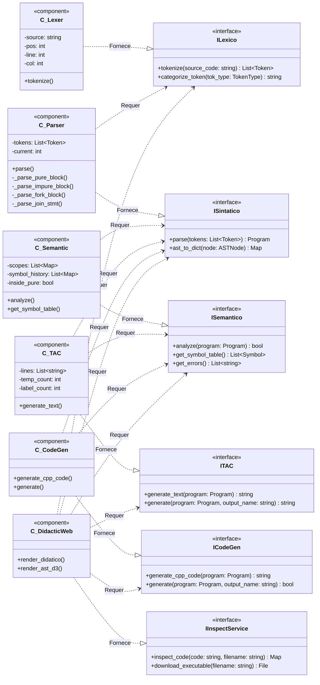
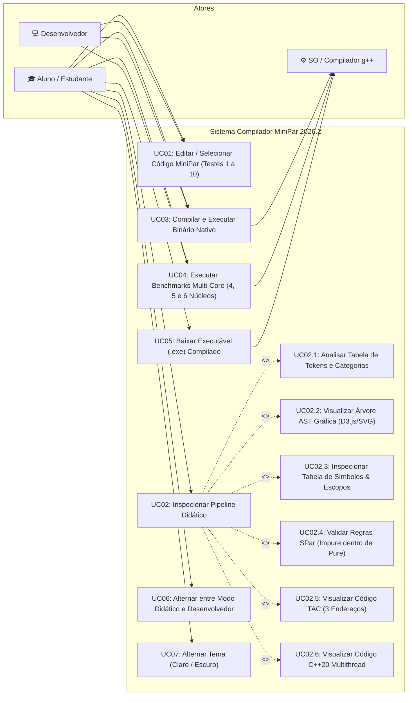
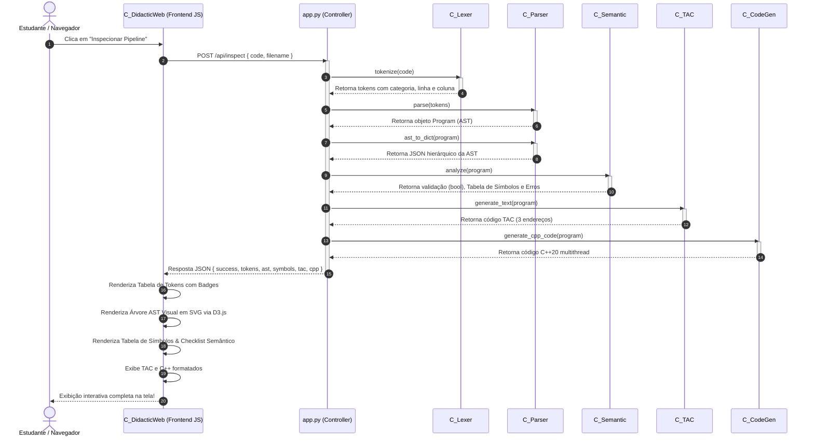
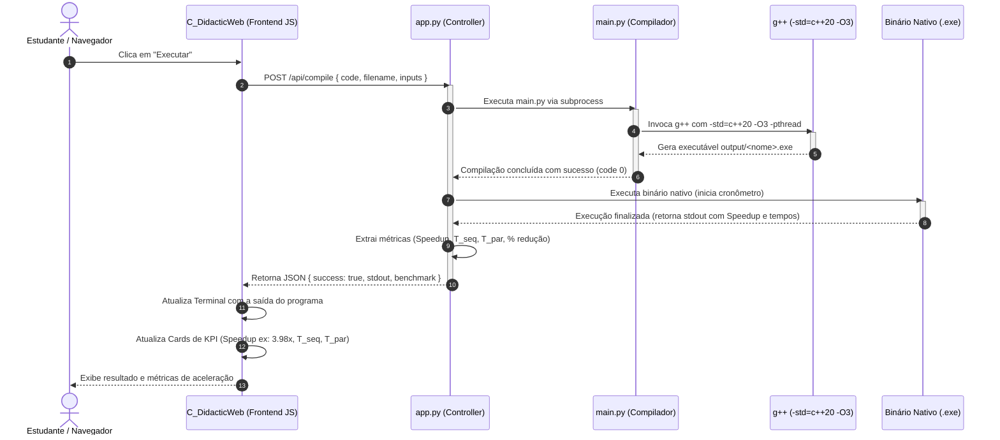

# Modelagem UML de Componentes de Software e Arquitetura — MiniPar 2026.2

**Projeto:** MiniPar 2026.2 — Compilador Source-to-Source Orientado a Objetos e Paralelo  
**Equipe:** Ludson Almeida · Davi Melo · Iury Nogueira  
**Instituição:** Universidade Federal de Alagoas (UFAL) — Instituto de Computação (IC)  
**Disciplina:** Compiladores — Prof. Arturo Hernandez Dominguez  

---

## 1. Visão Geral da Arquitetura

O compilador **MiniPar 2026.2** adota o paradigma de **Engenharia de Software Baseada em Componentes (CBSE - Component-Based Software Engineering)**. A arquitetura divide o pipeline de compilação em componentes de software modulares, independentes e fracamente acoplados, conectados através de **Interfaces Fornecidas (Provided Interfaces)** e **Interfaces Requeridas (Required Interfaces)**.

```
+-------------------------------------------------------------------------------------------------+
|                                 ARQUITETURA DE COMPONENTES MINIPAR 2026.2                       |
+-------------------------------------------------------------------------------------------------+
|                                                                                                 |
|   [Código .minipar]                                                                             |
|          |                                                                                      |
|          v                                                                                      |
|   +---------------+  ILexico   +---------------+  ISintatico  +---------------+                 |
|   |    C_Lexer    |----------->|   C_Parser    |------------->|  C_Semantic   |                 |
|   +---------------+ (Tokens)   +---------------+    (AST)     +---------------+                 |
|                                        |                             |                          |
|                                        | AST                         | AST Validada             |
|                                        v                             v                          |
|                                +---------------+             +---------------+                  |
|                                |     C_TAC     |             |   C_CodeGen   |                  |
|                                +---------------+             +---------------+                  |
|                                 (3-Endereços)                        | (C++20)                  |
|                                        |                             v                          |
|                                        |                      +---------------+                 |
|                                        |                      |  Compilador   |                 |
|                                        |                      |   g++ (-O3)   |                 |
|                                        |                      +---------------+                 |
|                                        v                             v                          |
|                                  [Arquivo .tac]               [Binário .exe]                    |
|                                                                                                 |
|   +-----------------------------------------------------------------------------------------+   |
|   |                            INTERFACES DE USUÁRIO (CAMADA DE APRESENTAÇÃO)               |   |
|   |                                                                                         |   |
|   |   +-------------------+    +--------------------+    +------------------------------+   |   |
|   |   |   C_CLI (Menu)    |    |   C_WebIDE (/)     |    |   C_DidacticWeb (/didatico)  |   |   |
|   |   |  Terminal ANSI    |    |  Tema Escuro 2026.1|    |   Árvore AST D3.js + Tokens  |   |   |
|   |   +-------------------+    +--------------------+    +------------------------------+   |   |
|   +-----------------------------------------------------------------------------------------+   |
+-------------------------------------------------------------------------------------------------+
```

---

## 2. Diagrama de Componentes de Software (UML 2.5)

Abaixo está o diagrama formal de componentes segundo a notação UML (com portas, interfaces requeridas e fornecidas):



### Especificação das Interfaces dos Componentes:

| Componente | Interface Fornecida | Interface Requerida | Papel no Pipeline |
| :--- | :--- | :--- | :--- |
| **`C_Lexer`** | `ILexico` | Nenhuma (Lê código bruto) | Converte o fluxo de caracteres em tokens (com suporte a `pure`, `impure`, `fork`, `join`). |
| **`C_Parser`** | `ISintatico` | `ILexico` | Constrói a Árvore Sintática Abstrata (AST) e a exporta para JSON hierárquico (`ast_to_dict`). |
| **`C_Semantic`** | `ISemantico` | `ISintatico` | Valida escopos, tipos e impõe a regra SPar (`impure` restrito a `pure`). Exporta Tabela de Símbolos. |
| **`C_TAC`** | `ITAC` | `ISintatico`, `ISemantico` | Gera Código de 3 Endereços com diretivas `BEGIN_PURE_MAP`, `ACQUIRE_LOCK`, `FORK_TASK`, `JOIN_TASKS`. |
| **`C_CodeGen`** | `ICodeGen` | `ISintatico`, `ISemantico` | Transpila a AST para C++20 multithread (`std::thread`, `std::mutex`, `std::lock_guard`) e invoca `g++`. |
| **`C_DidacticWeb`** | `IInspectService` | `ILexico`, `ISintatico`, `ISemantico`, `ITAC`, `ICodeGen` | Painel web educacional padrão IFSC com AST gráfica em SVG/D3.js, badges de tokens e download do `.exe`. |

---

## 3. Diagrama de Casos de Uso (UML Use Case)

Descreve todas as interações dos atores humanos (estudante e desenvolvedor) e externos (sistema operacional / compilador GCC) com o MiniPar 2026.2:



---

## 4. Diagrama de Classes UML (Nós da AST e Compilador)

### 4.1 Hierarquia dos Nós da AST (src/ast_nodes.py)

```mermaid
classDiagram
    direction TB

    class ASTNode {
        +int line
    }

    class Program {
        +List~ASTNode~ statements
    }

    class SeqBlock {
        +List~ASTNode~ statements
    }

    class ParBlock {
        +List~ASTNode~ statements
    }

    class PureBlock {
        +ASTNode body
    }

    class ImpureBlock {
        +List~ASTNode~ statements
    }

    class ForkBlock {
        +ASTNode body
        +string task_name
        +ASTNode cores
    }

    class JoinStmt {
        +List~string~ target_tasks
    }

    class ClassDecl {
        +string name
        +string superclass
        +List~VarDecl~ attributes
        +List~FuncDecl~ methods
    }

    class FuncDecl {
        +string name
        +List~string~ params
        +ASTNode body
    }

    class ForStmt {
        +ASTNode initializer
        +ASTNode condition
        +ASTNode increment
        +ASTNode body
    }

    class IfStmt {
        +ASTNode condition
        +ASTNode then_branch
        +ASTNode else_branch
    }

    class WhileStmt {
        +ASTNode condition
        +ASTNode body
    }

    class VarDecl {
        +string name
        +ASTNode init_value
        +string type
    }

    class BinaryExpr {
        +string op
        +ASTNode left
        +ASTNode right
    }

    class IdentifierExpr {
        +string name
    }

    class NumberExpr {
        +string value
    }

    ASTNode <|-- Program
    ASTNode <|-- SeqBlock
    ASTNode <|-- ParBlock
    ASTNode <|-- PureBlock
    ASTNode <|-- ImpureBlock
    ASTNode <|-- ForkBlock
    ASTNode <|-- JoinStmt
    ASTNode <|-- ClassDecl
    ASTNode <|-- FuncDecl
    ASTNode <|-- ForStmt
    ASTNode <|-- IfStmt
    ASTNode <|-- WhileStmt
    ASTNode <|-- VarDecl
    ASTNode <|-- BinaryExpr
    ASTNode <|-- IdentifierExpr
    ASTNode <|-- NumberExpr
```



---

## 5. Diagrama de Sequência UML (Fluxo de Inspeção Didática)

Demonstra como as requisições disparadas pelo usuário na Interface Didática (`POST /api/inspect`) percorrem sequencialmente todos os componentes do compilador:



---

## 6. Diagrama de Sequência UML (Compilação, Execução e Benchmark)

Demonstra o fluxo ao clicar em **"Executar"** com medição de **Speedup**:



